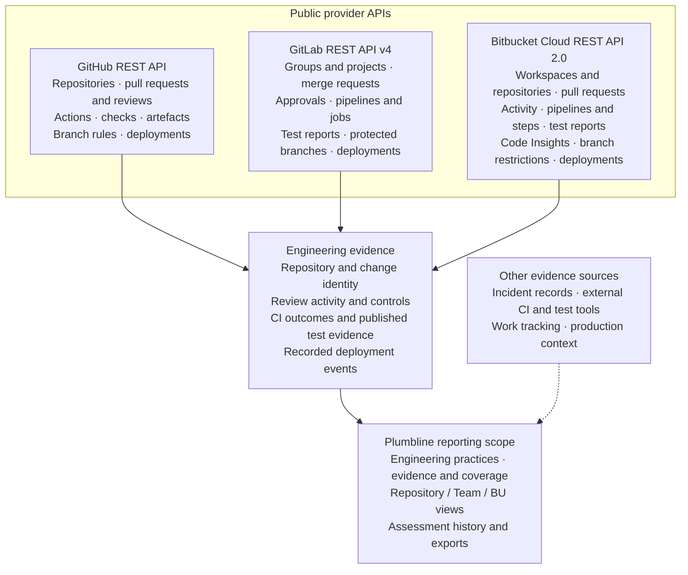
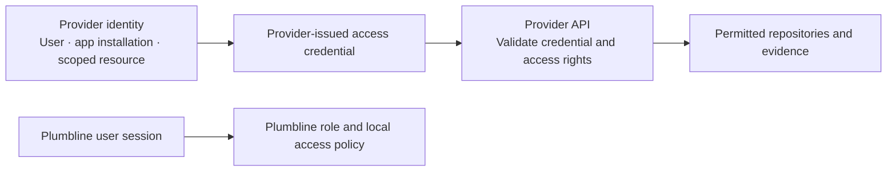

# Public provider API landscape

Reviewed against public vendor documentation on 14 November 2026.

This is a rough, conceptual view of the evidence exposed by GitHub, GitLab and
Bitbucket Cloud and its relationship to Plumbline's reporting scope. The arrows
represent evidence relationships. They do not claim that these Plumbline
integrations exist. There are no setup steps or implementation prescriptions.

## Authentication and access boundaries

There are two separate identities: the person signed into Plumbline, and the
identity used to read a provider's API. A Plumbline session does not grant access
to GitHub, GitLab or Bitbucket. Provider credentials determine which external
resources are visible; Plumbline's own roles govern access inside the application.
The following describes vendor authentication models, not completed integrations.

| Provider | Identity and credential | How API requests authenticate | What limits access |
| --- | --- | --- | --- |
| GitHub | A personal access token represents a user. A GitHub App can act as an installation or on behalf of a user. | REST requests carry an access token in the `Authorization: Bearer` header. For app installation access, an app JWT establishes the app identity and obtains a separate installation access token; the JWT is not the repository-reading credential. | Selected resources, endpoint permissions, the user or installation's access, and organisation policies. Fine-grained PAT permissions differ from classic PAT scopes. |
| GitLab | Personal tokens represent users; project/group tokens have a narrower resource boundary. OAuth access tokens represent delegated access. | Personal/project/group tokens use `PRIVATE-TOKEN` or supported Bearer authentication. OAuth access tokens use `Authorization: Bearer`. | Token scopes, account or bot role, resource membership and product tier. CI job tokens cover selected endpoints, not the complete API. |
| Bitbucket Cloud | Personal API tokens represent an Atlassian account. Repository/project/workspace access tokens represent their named resource. OAuth represents delegated user access or the consumer owner, depending on the grant. | Personal API tokens use HTTP Basic with Atlassian email and token. Resource access tokens and OAuth API requests use Bearer authentication. | Resource boundary, granted scopes, account access and plan availability. API-token scopes and OAuth scopes are distinct vocabularies. |

Sources: [GitHub REST authentication](https://docs.github.com/en/rest/authentication/authenticating-to-the-rest-api),
[GitHub App identities](https://docs.github.com/en/apps/creating-github-apps/authenticating-with-a-github-app/about-authentication-with-a-github-app),
[GitLab REST authentication](https://docs.gitlab.com/api/rest/authentication/),
[Bitbucket authentication](https://developer.atlassian.com/cloud/bitbucket/rest/intro/).

Conceptually, the access path is:

### Delegation, lifetime and evidence coverage

OAuth user delegation involves the provider authorising access and issuing an
access token. Where the grant supplies a refresh token, it supports renewal
without another interactive sign-in. This differs from supplying a pre-issued
personal or resource token. GitHub App installation access is also distinct from
user OAuth consent: it authorises the installed app over granted resources.
These are alternative vendor models; this document does not select one for the
planned Plumbline providers.

Tokens can expire or be revoked, and organisation policies can restrict access.
A working credential proves identity, not permission to read every endpoint.
Repository visibility does not establish access to branch controls, CI artefacts,
approvals or deployment records. Each endpoint's published permission requirements
remain authoritative; this diagram is not a complete scope checklist.

Bitbucket app passwords are deprecated. Personal API tokens require an expiry;
OAuth access tokens currently last one hour. A missing, expired or underprivileged
credential creates an evidence-coverage gap, not a zero score. Some providers can
hide inaccessible resources behind a not-found response, so HTTP status alone does
not establish whether the resource exists.

References: [Bitbucket token and OAuth lifecycle](https://developer.atlassian.com/cloud/bitbucket/rest/intro/),
[GitHub authentication failures](https://docs.github.com/en/rest/authentication/authenticating-to-the-rest-api),
[GitLab authentication errors](https://docs.gitlab.com/api/rest/authentication/).

## API families and evidence

| Evidence | GitHub | GitLab | Bitbucket Cloud |
| --- | --- | --- | --- |
| Repository context | [Repositories](https://docs.github.com/en/rest/repos/repos): repository identity, ownership and default branch | [Projects](https://docs.gitlab.com/api/projects/): project identity, namespace and repository context | [Repositories](https://developer.atlassian.com/cloud/bitbucket/rest/api-group-repositories/): repository UUID, workspace and main branch |
| Changes and review | [Pull requests](https://docs.github.com/en/rest/pulls/pulls) and [reviews](https://docs.github.com/en/rest/pulls/reviews): change state and submitted reviews | [Merge requests](https://docs.gitlab.com/api/merge_requests/) and [approvals](https://docs.gitlab.com/api/merge_request_approvals/): merge state and approval evidence | [Pull requests](https://developer.atlassian.com/cloud/bitbucket/rest/api-group-pullrequests/): change state, participants, activity and commits |
| Branch controls | [Branch rules](https://docs.github.com/en/rest/repos/rules) and [branch protection](https://docs.github.com/en/rest/branches/branch-protection) | [Protected branches](https://docs.gitlab.com/api/protected_branches/) and approval rules | [Branch restrictions](https://developer.atlassian.com/cloud/bitbucket/rest/api-group-branch-restrictions/) |
| CI execution | [Workflow runs](https://docs.github.com/en/rest/actions/workflow-runs) and [check runs](https://docs.github.com/en/rest/checks/runs): execution state and conclusions | [Pipelines](https://docs.gitlab.com/api/pipelines/) and [jobs](https://docs.gitlab.com/api/jobs/): pipeline/job state, timing and coverage fields | [Pipelines](https://developer.atlassian.com/cloud/bitbucket/rest/api-group-pipelines/): pipeline and step state and timing |
| Test and quality evidence | Check results and [published artefacts](https://docs.github.com/en/rest/actions/artifacts); a successful check alone does not establish test counts or coverage | Pipeline test reports and summaries, when reported by CI | Pipeline step test reports and [Code Insights reports](https://developer.atlassian.com/cloud/bitbucket/rest/api-group-reports/), when published |
| Delivery records | [Deployments and deployment statuses](https://docs.github.com/en/rest/deployments/deployments) | [Deployments](https://docs.gitlab.com/api/deployments/) and [environments](https://docs.gitlab.com/api/environments/) | [Deployments and environments](https://developer.atlassian.com/cloud/bitbucket/rest/api-group-deployments/) |

Representative API paths show the shape of these public surfaces:

| Provider | Repository | Change/review | CI evidence |
| --- | --- | --- | --- |
| GitHub | `/repos/{owner}/{repo}` | `/repos/{owner}/{repo}/pulls/{number}/reviews` | `/repos/{owner}/{repo}/actions/runs` |
| GitLab | `/api/v4/projects/{id}` | `/api/v4/projects/{id}/merge_requests/{iid}/approvals` | `/api/v4/projects/{id}/pipelines/{pipeline_id}/test_report` |
| Bitbucket Cloud | `/2.0/repositories/{workspace}/{repo_slug}` | `/2.0/repositories/{workspace}/{repo_slug}/pullrequests/{id}/activity` | `/2.0/repositories/{workspace}/{repo_slug}/pipelines/` |

## Operational and evidence constraints

The following answers are based on public documentation, checked on 14 November
2026. Provider facts and Plumbline architectural implications are separated.
Account-specific access, retention and throughput have not been measured.

### 1. Permissions differ by evidence family

A repository-readable credential is not a complete assessment credential. These
are concrete examples, not a universal minimum-permissions list:

| Provider | Documented examples | Consequence for coverage |
| --- | --- | --- |
| GitHub | Listing PR reviews requires fine-grained **Pull requests: read**; listing Actions artefacts requires **Actions: read**; reading classic branch protection requires **Administration: read**. Public-resource exceptions vary by endpoint. | Review and CI access do not establish branch-control access. Permission names below refer to fine-grained tokens/App permissions, not classic PAT scopes. |
| GitLab | API access depends on token scope and resource role. `read_api` is accepted by many read endpoints; project approval-rule endpoints are Premium/Ultimate features. | A valid token cannot supply a feature absent from the account's tier, and a broad scope does not remove role checks. |
| Bitbucket Cloud | PR commit reads use OAuth `pullrequest` or API-token `read:pullrequest:bitbucket`; step test-report reads use `pipeline` or `read:pipeline:bitbucket`; listing branch restrictions requires `repository:admin` or `admin:repository:bitbucket`. | Even reading branch controls requires an admin scope. OAuth and API-token scope names are not interchangeable. |

Sources: [GitHub reviews](https://docs.github.com/en/rest/pulls/reviews),
[Actions artefacts](https://docs.github.com/en/rest/actions/artifacts),
[branch protection](https://docs.github.com/en/rest/branches/branch-protection),
[GitLab authentication](https://docs.gitlab.com/api/rest/authentication/),
[approval rules](https://docs.gitlab.com/api/merge_request_approvals/),
[Bitbucket PRs](https://developer.atlassian.com/cloud/bitbucket/rest/api-group-pullrequests/),
[pipelines](https://developer.atlassian.com/cloud/bitbucket/rest/api-group-pipelines/)
and [branch restrictions](https://developer.atlassian.com/cloud/bitbucket/rest/api-group-branch-restrictions/).

### 2. Pagination and rate limits bound collection

| Provider | Published behaviour | Architectural implication |
| --- | --- | --- |
| GitHub | Collections expose continuation links in the `Link` header. Most paginated endpoints allow up to 100 records per page. Authenticated user REST access commonly has a 5,000-request hourly budget; installation and enterprise limits vary. Secondary limits also apply. | One successful page is not a complete collection. Separate requests made with the same identity can share its budget. |
| GitLab | Offset pagination defaults to 20 records, up to 100; keyset pagination exists for supported resources. Maximum offsets and endpoint limits apply. GitLab.com publishes plan, user, group and endpoint limits; self-managed limits can differ. | There is no single global request budget or pagination method that describes every GitLab endpoint. |
| Bitbucket Cloud | Collections expose `values` and an opaque `next` link; a total count is not guaranteed. The documented default API budget is 1,000 requests per rolling hour, with resource-group exceptions and eligible scaled limits up to 10,000. | Missing total counts do not establish incompleteness. Collection volume and available budget depend on the endpoint and authentication context. |

Sources: [GitHub pagination](https://docs.github.com/en/rest/using-the-rest-api/using-pagination-in-the-rest-api)
and [rate limits](https://docs.github.com/en/rest/using-the-rest-api/rate-limits-for-the-rest-api),
[GitLab pagination](https://docs.gitlab.com/api/rest/)
and [GitLab.com limits](https://docs.gitlab.com/user/gitlab_com/rate_limits/),
[Bitbucket pagination](https://developer.atlassian.com/cloud/bitbucket/rest/intro/#pagination)
and [request limits](https://support.atlassian.com/bitbucket-cloud/docs/api-request-limits/).

Inference: repository count alone cannot establish a collection duration. Pages,
changes, builds, evidence requests, shared quotas and throttling also determine
cost. No throughput estimate or maximum supported estate is established here.

### 3. Historical evidence is not permanently available

| Provider | Documented boundary | What can be concluded |
| --- | --- | --- |
| GitHub | Artefact metadata includes expiry information; the download endpoint documents `410 Gone`. | A retained workflow result does not guarantee a downloadable test or coverage artefact. |
| GitLab | Artefacts have expiry/retention behaviour, including exceptions for retained recent pipelines. Deleted artefacts cannot be recovered through the API. | An old pipeline's status and its report contents have different availability. |
| Bitbucket Cloud | Pipeline artefacts are stored for 14 days. | Older exported reports cannot be assumed recoverable from pipeline artefacts. This period is not a claim about test-report or deployment-record retention. |

Sources: [GitHub artefacts](https://docs.github.com/en/rest/actions/artifacts),
[GitLab artefacts](https://docs.gitlab.com/api/job_artifacts/)
and [Bitbucket artefact retention](https://support.atlassian.com/bitbucket-cloud/docs/use-bitbucket-artifacts-in-step/).

Inference: today's branch rules and repository metadata do not prove the settings
in effect at an earlier merge. An API date filter is not a historical snapshot.
The public surfaces above do not establish complete point-in-time reconstruction.

### 4. Similar fields do not establish equivalent practices

GitHub exposes submitted review states. GitLab's `approved_by` lists approvers
even when those approvals do not satisfy a required rule. Bitbucket distinguishes
PR participants, approvals and activity. Assigned/requested reviewers therefore
cannot stand in for completed approval, and an approval does not alone prove that
all merge requirements were satisfied.
[GitHub reviews](https://docs.github.com/en/rest/pulls/reviews),
[GitLab approval semantics](https://docs.gitlab.com/api/merge_request_approvals/),
[Bitbucket PR evidence](https://developer.atlassian.com/cloud/bitbucket/rest/api-group-pullrequests/).

Branch controls also describe different things: GitHub protection/rules, GitLab
protected branches and approval rules, and Bitbucket restriction kinds are not a
single shared Boolean. Architectural implication: cross-provider comparisons need
explicit definitions and coverage boundaries; equal field names or successful
pipeline states do not establish equal engineering controls.

### 5. Identity includes provider and resource scope

GitHub repository responses expose numeric `id` and `node_id`; GitLab projects
have numeric IDs alongside namespace paths; Bitbucket exposes repository and
workspace UUIDs alongside human-readable names. PR/MR numbers are scoped to their
repository or project. Names, paths and visible numbers alone do not establish
global identity.
[GitHub repository fields](https://docs.github.com/en/rest/repos/repos),
[GitLab project fields](https://docs.gitlab.com/api/projects/),
[Bitbucket repository fields](https://developer.atlassian.com/cloud/bitbucket/rest/api-group-repositories/).

Architectural implication: evidence identity includes its provider/host and parent
resource. Renames can change display paths; forks, copies and cross-provider
migrations are not proven to be the same repository by a matching name or commit.
The sources reviewed do not establish universal ID continuity across migrations.

### 6. Missing evidence has several causes

GitHub documents that inaccessible private resources can return `404`. GitLab
distinguishes invalid/missing authentication from insufficient token scope.
Bitbucket endpoint references list separate authentication, authorisation and
not-found outcomes. A successful list is also limited to resources visible to
that identity.
[GitHub troubleshooting](https://docs.github.com/en/rest/using-the-rest-api/troubleshooting-the-rest-api),
[GitLab authentication errors](https://docs.gitlab.com/api/rest/authentication/),
[Bitbucket branch-restriction responses](https://developer.atlassian.com/cloud/bitbucket/rest/api-group-branch-restrictions/).

Architectural interpretation: observed empty, unsupported, inaccessible, failed,
expired and not-yet-published evidence are different states. A completed page or
run is not proof of organisation-wide coverage. Public APIs cannot enumerate the
private resources an identity is forbidden to discover. The organisation's own
inventory is needed to establish that denominator.

### 7. Read-only evidence can still be sensitive

PR responses contain authors and free text; review responses contain users and
comments. Logs and report artefacts can contain credentials as well as personal
or proprietary information. GitLab explicitly warns that CI variables can leak
into job logs; masking does not guarantee prevention of disclosure.
[GitHub review payloads](https://docs.github.com/en/rest/pulls/reviews),
[Bitbucket PR payloads](https://developer.atlassian.com/cloud/bitbucket/rest/api-group-pullrequests/),
[GitLab variable security](https://docs.gitlab.com/ci/variables/#cicd-variable-security).

Inference: read-only API access is not a privacy classification. Numeric aggregates
can still identify a small team or repository through their history. This research
does not establish that provider responses, application exports or the example
aggregates are safe for unrestricted redistribution.

### 8. Deployments need production and incident context

GitHub, GitLab and Bitbucket expose deployment/environment records. GitHub also
documents environment jobs that deliberately create no deployment object. Thus
absence of a deployment record does not prove absence of delivery, while a record
or successful build alone does not prove a successful production release.
[GitHub environment behaviour](https://docs.github.com/en/actions/how-tos/write-workflows/choose-what-workflows-do/deploy-to-environment),
[GitLab deployments](https://docs.gitlab.com/api/deployments/),
[Bitbucket deployments](https://developer.atlassian.com/cloud/bitbucket/rest/api-group-deployments/).

Architectural implication: production designation, the relationship between a
change and its deployment, and incident/recovery evidence remain separate facts.
None of the selected SCM endpoints alone establishes the organisation's complete
production or incident history. The organisation-specific meaning of production
and recovery remains unresolved by public documentation.

### 9. Access to stored evidence is a separate boundary

Provider token revocation stops future authorised reads; it does not retract
copies already stored by another application. This is an architectural consequence
of copying evidence, not a vendor promise of permission synchronisation.

Current Plumbline source uses a Viewer/Admin application guard: authenticated
viewers can access read routes, including run-owned downloads. The inspected guard
and download routes do not enforce per-repository provider membership. Run-owned
file checks constrain file paths, not which organisation members may see a run.
[Application guard](../src/plumbline/auth/guard.py),
[run and download routes](../src/plumbline/api/main.py).

Consequently, provider access and Plumbline report visibility are not equivalent.
Repository-level report permissions, access changes after collection, retained
copies and export recipients remain product-policy decisions. This document does
not claim those policies are implemented or that source review is runtime proof.

### 10. What is answered, and what remains unverified

| Evidence level | What it establishes here | What it does not establish |
| --- | --- | --- |
| Official provider documentation | Available endpoint families, authentication models, published permission examples and service constraints. | This account's licence, policies, granted scopes, inventory or actual responses. |
| Local source inspection | The current Plumbline guard and download access model described above. | Deployed behaviour, a security review or completed future-provider integration. |
| Fixtures and synthetic checks | Behaviour against their supplied scenarios, when actually run. | Vendor parity, complete API-shape coverage or live permissions. No new checks of this kind were run for this documentation update. |
| Authenticated live collection | Not performed for this research. | No account-specific completeness, history, performance or data-sensitivity claim is made. |

Publicly answered constraints are recorded above. The remaining questions require
organisation information or product decisions: intended inventories and plans;
chosen credential model and acceptable privileges; each evidence type's actual
retention; production/incident definitions; report audience, retention and deletion
policy; and comparable scoring definitions. These cannot be settled from public
API documentation. No implementation, live collection or configuration changes
were made to answer them.

## Boundaries of this picture

API availability is different from accessible evidence. Account permissions,
subscription features, CI configuration and retention affect which records exist
and can be read. An absent or inaccessible result does not establish a measured
zero. These are architectural interpretation boundaries, not live verification.

The providers expose different control and review concepts. A protection rule, a
requested reviewer and a submitted approval describe different things. Pipeline
success and a deployment record also describe different events; neither alone
establishes a successful production release or an incident recovery.

Test totals, coverage and security findings depend on published evidence and its
format. This diagram makes no claim that every repository supplies every metric,
or that an artefact name proves a security scan succeeded. Incident and
work-tracking evidence may sit outside the SCM platform.

The conceptual reporting hierarchy is **BU → Team → Repository**. Segments and
Grafana are excluded. Current Plumbline collection supports Azure DevOps and a
diagnostic synthetic dataset; GitHub, GitLab and Bitbucket Cloud remain planned
providers. No authenticated requests to those providers were made for this document.
