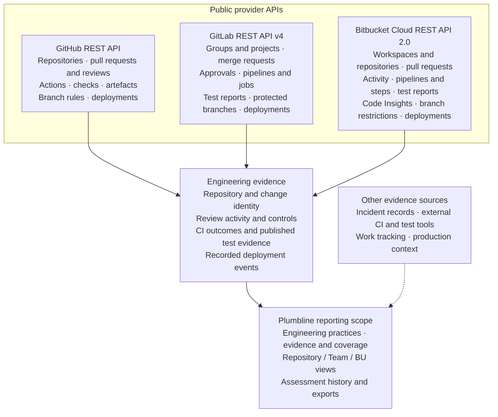

# Public provider API landscape

Reviewed against public vendor documentation on 14 November 2026.

This is a rough, conceptual view of the evidence exposed by GitHub, GitLab and
Bitbucket Cloud and its relationship to Plumbline's reporting scope. The arrows
represent evidence relationships. They do not claim that these Plumbline
integrations exist. There are no setup steps or implementation prescriptions.

## API families and evidence

| Evidence | GitHub | GitLab | Bitbucket Cloud |
| --- | --- | --- | --- |
| Repository context | [Repositories](https://docs.github.com/en/rest/repos/repos): repository identity, ownership and default branch | [Projects](https://docs.gitlab.com/api/projects/): project identity, namespace and repository context | [Repositories](https://developer.atlassian.com/cloud/bitbucket/rest/api-group-repositories/): repository UUID, workspace and main branch |
| Changes and review | [Pull requests](https://docs.github.com/en/rest/pulls/pulls) and [reviews](https://docs.github.com/en/rest/pulls/reviews): change state and submitted reviews | [Merge requests](https://docs.gitlab.com/api/merge_requests/) and [approvals](https://docs.gitlab.com/api/merge_request_approvals/): merge state and approval evidence | [Pull requests](https://developer.atlassian.com/cloud/bitbucket/rest/api-group-pullrequests/): change state, participants, activity and commits |
| Branch controls | [Branch rules](https://docs.github.com/en/rest/repos/rules) and [branch protection](https://docs.github.com/en/rest/branches/branch-protection) | [Protected branches](https://docs.gitlab.com/api/protected_branches/) and approval rules | [Branch restrictions](https://developer.atlassian.com/cloud/bitbucket/rest/api-group-branch-restrictions/) |
| CI execution | [Workflow runs](https://docs.github.com/en/rest/actions/workflow-runs) and [check runs](https://docs.github.com/en/rest/checks/runs): execution state and conclusions | [Pipelines](https://docs.gitlab.com/api/pipelines/) and [jobs](https://docs.gitlab.com/api/jobs/): pipeline/job state, timing and coverage fields | [Pipelines](https://developer.atlassian.com/cloud/bitbucket/rest/api-group-pipelines/): pipeline and step state and timing |
| Test and quality evidence | Check results and [published artefacts](https://docs.github.com/en/rest/actions/artifacts); a successful check alone does not establish test counts or coverage | Pipeline test reports and summaries, when reported by CI | Pipeline step test reports and [Code Insights reports](https://developer.atlassian.com/cloud/bitbucket/rest/api-group-reports/), when published |
| Delivery records | [Deployments and deployment statuses](https://docs.github.com/en/rest/deployments/deployments) | [Deployments](https://docs.gitlab.com/api/deployments/) and [environments](https://docs.gitlab.com/api/environments/) | [Deployments and environments](https://developer.atlassian.com/cloud/bitbucket/rest/api-group-deployments/) |

Representative API paths show the shape of these public surfaces:

| Provider | Repository | Change/review | CI evidence |
| --- | --- | --- | --- |
| GitHub | `/repos/{owner}/{repo}` | `/repos/{owner}/{repo}/pulls/{number}/reviews` | `/repos/{owner}/{repo}/actions/runs` |
| GitLab | `/api/v4/projects/{id}` | `/api/v4/projects/{id}/merge_requests/{iid}/approvals` | `/api/v4/projects/{id}/pipelines/{pipeline_id}/test_report` |
| Bitbucket Cloud | `/2.0/repositories/{workspace}/{repo_slug}` | `/2.0/repositories/{workspace}/{repo_slug}/pullrequests/{id}/activity` | `/2.0/repositories/{workspace}/{repo_slug}/pipelines/` |

## Boundaries of this picture

API availability is different from accessible evidence. Account permissions,
subscription features, CI configuration and retention affect which records exist
and can be read. An absent or inaccessible result does not establish a measured
zero. These are architectural interpretation boundaries, not live verification.

The providers expose different control and review concepts. A protection rule, a
requested reviewer and a submitted approval describe different things. Pipeline
success and a deployment record also describe different events; neither alone
establishes a successful production release or an incident recovery.

Test totals, coverage and security findings depend on published evidence and its
format. This diagram makes no claim that every repository supplies every metric,
or that an artefact name proves a security scan succeeded. Incident and
work-tracking evidence may sit outside the SCM platform.

The conceptual reporting hierarchy is **BU → Team → Repository**. Segments and
Grafana are excluded. Current Plumbline collection supports Azure DevOps and a
diagnostic synthetic dataset; GitHub, GitLab and Bitbucket Cloud remain planned
providers. No authenticated requests to those providers were made for this document.
